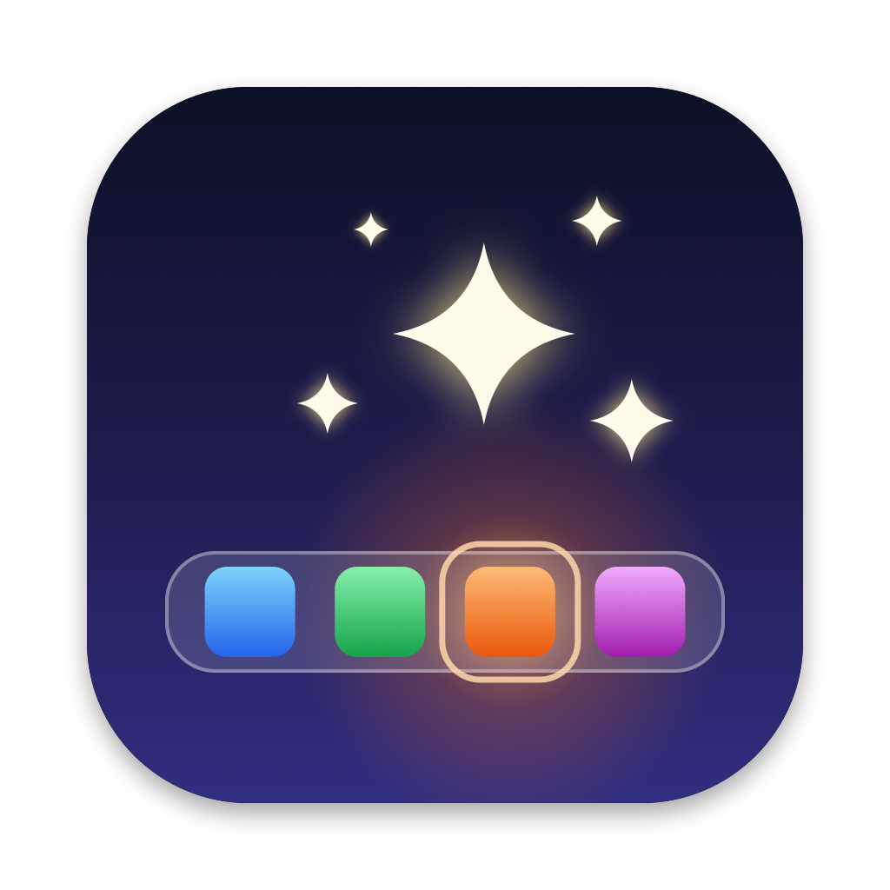

<p align="center">
  
</p>

<h1 align="center">DockFX</h1>

<p align="center">
  Glows, shines, sparkles and ripples for your Mac's Dock.<br>
  Free, open source, and light on battery.
</p>

<!-- TODO: once there are clips (scripts/make-video.swift), put the main one here:
<p align="center">
  
</p>
-->

<p align="center">
  <a href="https://github.com/doom1337hvh/DockFX/releases/latest"><b>Download</b></a> ·
  <a href="#install">Install</a> ·
  <a href="#in-action">In action</a> ·
  <a href="#settings">Settings</a>
</p>

DockFX lives in the menu bar and plays small light effects on the Dock: on the icon you point at,
on an app's icon once it has opened, on the app you switch to, along the whole Dock as it slides
in, or gently all the time. Pick a look for each moment in Settings, or turn any of them off. The
effects are drawn in a see-through window just above the Dock, so the Dock itself, and clicking
it, work exactly as before.

## Features

- **Four looks:** Glow (a soft glow around the icon), Shine (a band of light across it, like light on glass), Sparkles (small glowing dots that burst off it and drift up) and Ripple (rings spreading from it).
- **In each icon's own shape:** glows, shines, ripples and the flash behind the sparkles follow the outline of the icon's picture, so a folder glows folder-shaped and the Trash bin-shaped. A notification badge counts as part of the icon: glows and ripples go around it, and nothing is drawn over it.
- **Five moments:** pointing at an icon, an app opening, switching apps, the Dock sliding in, and all the time. Each has its own tab in Settings, with its own look, or none.
- **Tune each one:** strength, size and speed for every moment, how many sparkles, how many ripple rings, and its own colour.
- **In each app's colours:** an icon's effect takes the main colour of its icon, so a red icon glows red. Or use your accent colour, white, or a colour of your own.
- **Joined to the icons:** each effect moves with its icon, and slides away and fades with the Dock when it hides.
- **Along the whole Dock:** as the Dock slides in (when it hides itself, or over a full-screen app), a wave of the look runs from one end to the other; Ripple spreads a ring in the Dock's own shape.
- **Try It** on each moment's tab plays it as it's set; **Try a Look** in the menu bar menu plays each look on every icon, to compare them.
- **Any Dock:** bottom, left or right, on whichever screen it's on. Every effect is sized to its icon, so it fits any Dock size, and grows and shrinks with the icon under magnification.
- **Built for battery life:** no Dock icon and nothing running in the background that doesn't need to. See [Battery](#battery).

Everything above can be switched off or changed in Settings.

## In action

Click one to watch it.

<!-- TODO: one <details> per clip in docs/clips:
<details>
<summary><b>Scene name</b>: what it shows.</summary>
<p align="center"></p>
</details>
-->

## Requirements

- A Mac with Apple silicon, running macOS 14 Sonoma or later

## Install

1. Download `DockFX-<version>.dmg` (or the `.zip`) from the [latest release](https://github.com/doom1337hvh/DockFX/releases/latest).
2. Drag **DockFX** into your **Applications** folder. Don't run it from Downloads: macOS runs apps opened there from a temporary copy, and the permissions you give that copy don't stick.
3. Open DockFX. macOS will say *"Apple could not verify 'DockFX' is free of malware"*. Click **Done**.
4. Open **System Settings → Privacy & Security**, scroll down to **Security**, and click **Open Anyway** next to *"DockFX was blocked"*. Confirm with **Open Anyway** and your password or Touch ID.
5. DockFX asks for **Accessibility**, to see where the icons are (see [Permissions](#permissions)). Click **Open System Settings** and switch on DockFX. The effects start straight away.

**Why the warning?** Apple only vouches for ("notarizes") apps whose developers pay for an Apple Developer account. DockFX is a free project and isn't notarized. The source code is all here, and you can [build it yourself](#build-from-source) instead.

**Prefer Terminal?** Instead of steps 3 and 4, run this, then open the app normally:

```bash
xattr -dr com.apple.quarantine /Applications/DockFX.app
```

**Check your download (optional):** each release lists SHA-256 checksums in `SHA256SUMS.txt`. Compare them with:

```bash
shasum -a 256 ~/Downloads/DockFX-*.dmg
```

## Updating

Quit DockFX (menu bar icon → Quit), replace the app in Applications with the new one, and open it. Each new download needs **Open Anyway** once more. Your permissions carry over, because every release is signed with the same certificate. If a release ever can't be, its notes will say so, and you'll need to allow them again.

## Permissions

| Permission | Asked when | What it's for |
|---|---|---|
| **Accessibility** | You first open DockFX | Finding where each icon is in the Dock, which one the pointer is over, and whether the Dock is showing. DockFX reads nothing else, and never presses or types anything. |
| **Login Items** | You turn on **Launch at login** | Starting DockFX when you log in. |

**Privacy:** DockFX never connects to the internet. It has no analytics, no accounts and no update checks. Your settings stay on your Mac.

## Settings

Open Settings from the menu bar icon, or by opening DockFX again while it's running (useful if you've hidden the menu bar icon).

**General:** launch at login and the menu bar icon; while Accessibility isn't allowed, an **Allow…** button for it; then **Turn on DockFX** (on by default), the main switch, also in the menu bar menu.

**Pointing, Opening, Switching, Sliding In, Always:** a tab for each moment, each set on its own:
- **Look:** Off, Glow, Shine, Sparkles or Ripple. By default Glow when **Pointing** at an icon, Sparkles on an app's icon once it has finished **Opening**, Ripple on the icon of the app you're **Switching** to, Shine along the Dock as it's **Sliding In** (when it hides itself or an app is full screen), and nothing **Always**. Always keeps a gentle version going along the Dock while it shows: a slow wave of glow, a shine every few seconds, dots rising gently off the icons, or a ripple every few seconds.
- **Strength** (100%, from 25% to 150%): how bright and solid it is.
- **Size** (100%, from 50% to 200%): how far a glow spreads, how wide the band of light is, how big the dots are and how high they rise, or how far the rings spread.
- **Speed** (1×, from 0.5× to 2×): how quickly it plays, and for Always, how often it comes round.
- **Amount** (Sparkles only, 100%, from 25% to 300%): how many dots.
- **Rings** (Ripple only, 2, up to 4): how many rings spread out, one after another.
- **Colour** (From each app's icon): from each app's icon (grey icons get white), your accent colour, white, or a custom colour.
- **Try It:** plays it on every icon one after another, or along the Dock. On Always, changes show on the Dock as you make them.
- **Reset:** puts the look's settings back to normal.

**About:** the version, a link here, and the licences.

## Battery

DockFX waits for macOS to tell it something happened, and doesn't check anything on a timer:
- Pointing at icons, apps opening and switching apps are notifications from macOS and the Dock.
- Only for **The Dock slides in** and **All the time** does it follow the pointer, to notice it
  reaching the edge of the screen. That's a quick comparison for each movement, and it reads the
  Dock's position only when the pointer reaches the edge or leaves the Dock.
- The window the effects are drawn in is only on screen while one plays, so it never sits over a
  full-screen video. The effects are drawn by Core Animation, outside the app.
- While an effect plays, DockFX reads where the Dock and the icon are about 60 times a second, so
  the effect moves with them. It stops as soon as the effect is over.

**All the time** costs the most: its effect is redrawn on every frame while the Dock shows, though
it stops while the Dock is hidden. Sparkles is the busiest look for it.

## Troubleshooting

- **Nothing happens:** check that Accessibility is allowed (the menu bar menu warns if it isn't), that **Turn on DockFX** is on, and that the Dock is showing: effects only play on a Dock that's on screen. **Try a Look** in the menu bar menu shows whether drawing works at all.
- **DockFX is switched on under Accessibility, but still says it isn't allowed:** macOS may still have an older copy of DockFX on record. In **System Settings → Privacy & Security → Accessibility**, select DockFX, remove it with **−**, then open DockFX again.
- **An effect is a little off the icon:** DockFX reads where the icons are from the Dock, about 60 times a second while an effect plays. A macOS update could change what the Dock reports.

## Uninstall

Quit DockFX (menu bar icon → Quit), delete it from Applications, and optionally remove its settings:

```bash
defaults delete io.github.doom1337hvh.DockFX
```

You can also remove it from the lists in **System Settings → Privacy & Security**.

## Build from source

You need the Xcode Command Line Tools (`xcode-select --install`); Xcode itself isn't needed.

```bash
git clone https://github.com/doom1337hvh/DockFX.git
```

```bash
cd DockFX && scripts/build.sh
```

The app is built to `build/DockFX.app`. `scripts/build.sh --install` also copies it to `~/Applications` and opens it there. The menu bar icon, Settings window and build scripts come from [AppShell](https://github.com/doom1337hvh/AppShell), which Swift Package Manager fetches on the first build.

Optionally, run `scripts/create-signing-cert.sh` once first. It makes a local code-signing certificate, so the permissions you grant survive rebuilds; otherwise each build is signed ad hoc and macOS treats it as a new app. To make a release, see [docs/RELEASING.md](docs/RELEASING.md).

### How it works

macOS doesn't let other apps change the Dock's own animations, so DockFX draws on top of it.

- **Reading the Dock:** `Dock` reads the Dock through the Accessibility API, as assistive apps
  do: its bar and each tile's frame, title and the app or file it opens. The Dock tells it, with
  an accessibility notification, whenever the pointer moves onto another tile.
- **The moments:** `DockWatcher` turns those, and macOS's notices of apps opening and coming to
  the front, into effects on the right tile, finding an app's tile by where it's installed. For the
  Dock sliding in, it watches for the pointer reaching the edge of the screen, then reads the Dock
  until it has stopped moving; when the pointer has left the Dock, it checks whether it has hidden.
- **Drawing:** `Stage` puts a borderless, click-through window just above the Dock's level and
  the room above it, and `Painter` in `Looks.swift` draws each look with Core Animation, to the
  moment's style (strength, size, speed and so on): a glow in the icon's shape for Glow, a
  masked gradient band for Shine, glowing dots on eased, curving paths for Sparkles, and
  spreading outlines for Ripple. Along a Dock on the left or right, everything is turned.
- **Joined to the icons:** while anything plays, `Stage` reads the Dock's bar and each effect's
  tile 60 times a second and moves the effect with it, fading everything as the Dock slides out
  of sight, and dropping it once the Dock is hidden.
- **Shapes and colours:** `IconShapes` takes each icon's outline from its picture (the one macOS
  gives for the app, folder or file), leaving out its soft shadow, adds the notification badge
  the Dock reports for it, drawn where and as wide as the Dock draws it, and with Core Image
  blurs that into a glow or grows it into a ring. `IconColors` shrinks the picture to 24 by 24 pixels and
  averages it, counting colourful pixels most, then brightens the result.

The app itself is SwiftUI in an AppKit shell, with the menu bar icon and Settings window from
AppShell:

```
Sources/DockFX/
  AppDelegate.swift, main.swift   app lifecycle, menu bar menu, Settings tabs
  Dock.swift                      reading the Dock: its bar, tiles and the tile pointed at
  DockWatcher.swift               the moments effects play at, and the Dock sliding in and out
  Stage.swift                     the window over the Dock that effects are drawn in
  Looks.swift                     Glow, Shine, Sparkles and Ripple, on an icon, along the Dock
                                  and all the time
  IconShapes.swift                an icon's outline, and a glow and a ring in its shape
  IconColors.swift                an icon's picture and its main colour
  Preferences.swift               the moments, and each one's look and style
  Permissions.swift, SettingsView.swift
scripts/                          build, release and signing certificate (AppShell's, run for
                                  DockFX), icon
```

## License

DockFX is released under the [MIT License](LICENSE).
